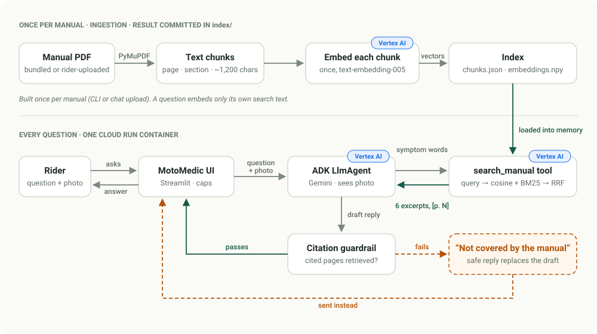
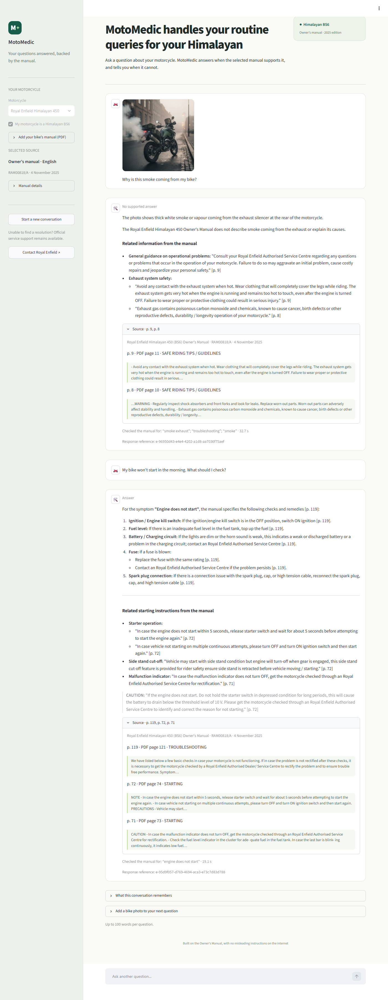
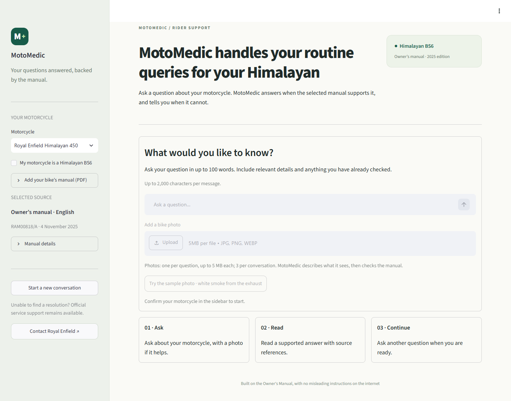
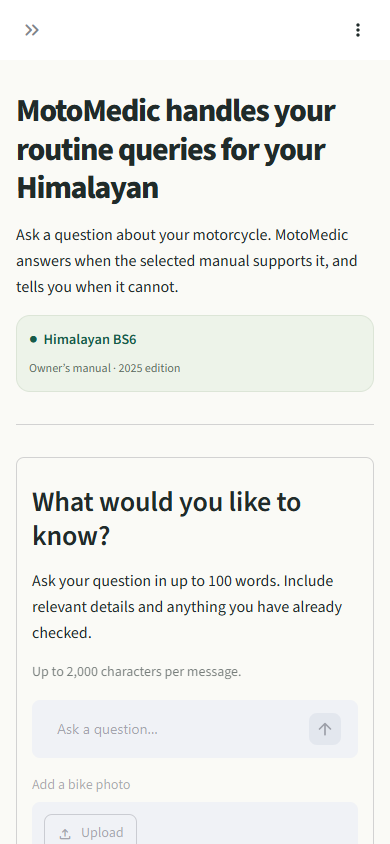

# RAGAgent

**The MotoMedic rider experience rebuilt on Google ADK + Vertex AI.**

[](https://github.com/Maneshwar-Kumar/RAGAgent/actions/workflows/ci.yml)

RAGAgent troubleshoots a motorcycle using only that bike's owner's or service manual. It is
one [Google Agent Development Kit (ADK)](https://google.github.io/adk-docs/) agent running
Gemini on Vertex AI, with hybrid (semantic + keyword) retrieval over the manual's text. Every
fact in an answer carries a page citation from the manual. When the manual does not cover a
question, the agent says **"Not covered by the manual"** and does not guess. A deterministic
check rejects any answer that cites a page the agent never retrieved. Riders can attach a photo
(the agent describes only what is visible, then searches the manual) or add their own bike's
PDF manual. Why this matters: motorcycle advice found online is plentiful and often wrong, so for
a rider a page in the official manual, or an honest "the manual doesn't say", is more useful and
safer than a confident guess.

The demo is set up for two manuals: the **Royal Enfield Himalayan 450 (BS6)** and the
**TVS Ronin** owner's manuals. Both are in the repo with their prebuilt index, so it runs
straight after cloning. You can add any other text-based PDF manual.

## How it works

<picture>
  <source media="(prefers-color-scheme: dark)" srcset="docs/images/how-it-works-dark.svg">
  
</picture>

- **Top lane, once per manual.** The PDF's text is split into passages that keep their page
  number and section, and each passage is embedded once with Vertex AI `text-embedding-005`.
  The resulting index is committed in [`index/`](index/), so cloning, running or deploying
  never re-embeds a manual. Only a new manual (added from the CLI or uploaded in the chat) is
  indexed, once.
- **Bottom lane, every question.** The ADK agent (Gemini on Vertex AI) can read manual text only
  through the `search_manual` tool. The tool embeds just the search words, ranks passages by
  meaning and by keywords, and returns six passages with page labels.
- **The guardrail decides what the rider sees.** It is plain Python, not a model. It checks
  that every page the draft cites was actually retrieved. If not, the rider gets *Not covered
  by the manual* instead.

## Try it

Hosted demo (Cloud Run; it scales to zero, so the first request after a quiet period is slower):

**[ragagent-551468477103.us-central1.run.app](https://ragagent-551468477103.us-central1.run.app)** — no sign-in needed.

What to try:

- **The white-smoke photo.** Pick *Royal Enfield Himalayan 450*, tick *My motorcycle is a
  Himalayan BS6*, then press **Try the sample photo · white smoke from the exhaust**. The photo is
  [`samples/white_smoke.jpg`](samples/white_smoke.jpg) (AI-generated). Neither manual explains
  white exhaust smoke, so the reply is labelled *No supported answer*. It describes what the
  photo shows and lists only related, cited sections, with no invented causes.
- **A covered symptom.** "My bike won't start in the morning. What should I check?" You get
  numbered checks from the manual's troubleshooting table. Open **Source · p. …** under the
  answer to read the exact excerpts that were cited.
- **Something no manual answers.** "Which aftermarket exhaust gives the most power?"
- **The other bike.** Start a new conversation, switch to *TVS Ronin*, tick *My motorcycle is
  a TVS Ronin* and ask "The ABS lamp stays on after I start riding. What should I do?"
- **Your own manual.** In the sidebar, open *Add your bike’s manual (PDF)*, press *Index this
  manual*, then tick *This manual is for my motorcycle*. The PDF must have selectable text,
  and can be up to 40 MB and 400 pages. Indexing takes about a minute per 150 pages.
- **Try to make it guess.** Ask for a torque value, part number or service interval that the
  manual doesn't list.



<details>
<summary>Start screen and phone layout</summary>





</details>

### Example exchange

These are real outputs from `python scripts/demo.py` (Vertex AI, `gemini-3.8-flash`,
Himalayan 450 manual selected, 12 Oct 2026), abridged with `[…]`. The rider UI shows the same
answer, with the status line turned into a label. All eight scenarios are in
[docs/SAMPLE_TRANSCRIPTS.md](docs/SAMPLE_TRANSCRIPTS.md).

> **Rider** *(attaches `samples/white_smoke.jpg`)*: Why is this smoke coming from my bike?
>
> *Manual searches: `smoke`, `troubleshooting`, `exhaust`*
>
> **Not covered by the manual**
>
> The photo shows white smoke/vapour coming from the exhaust of the motorcycle.
>
> The owner's manual does not describe exhaust smoke or its causes.
>
> **Related information from the manual**
> - **Consulting a service centre:** "Consult your Royal Enfield Authorised Service Centre regarding any questions or problems that occur in the operation of your motorcycle. Failure to do so may aggravate an initial problem, cause costly repairs and jeopardize your personal safety." [p. 9]
> - **Exhaust system caution:** "Avoid any contact with the exhaust system when hot. […]" [p. 9]
> - **Exhaust gas warning:** "Exhaust gas contains poisonous carbon monoxide and chemicals […]" [p. 8]

> **Rider**: My bike won't start in the morning. What should I check?
>
> *Manual searches: `engine does not start`*
>
> **From the manual**
>
> According to the troubleshooting guide for when the engine does not start, perform the following checks [p. 119]:
> - **Ignition/Engine kill switch:** If it is in the OFF position, switch ON the ignition [p. 119].
> - **Fuel level:** If there is inadequate fuel level in the fuel tank, top up the fuel [p. 119].
> - **Battery / charging circuit:** If the lights are dim or the horn sound is weak, this indicates a weak or discharged battery or a problem in the charging circuit; contact an Authorised service center [p. 119].
> - **Fuses:** If a fuse is blown, replace the fuse with the same rating [p. 119]. Contact an Authorised service center if the problem persists [p. 119].
> - **Spark plug connections:** If there is a connection issue with the spark plug, cap, or high tension cable, reconnect the spark plug, cap, and high tension cable [p. 119].
>
> […] "CAUTION: If the engine does not start. Do not hold the starter switch in depressed condition for long periods, this will cause the battery to drain below the threshold level of 10 V. […]" [p. 72]

## How grounding is enforced

Three layers, from soft to hard:

1. **Retrieval is the only way in.** The prompt names the loaded manuals but contains none of
   their text. Manual content reaches the model only through the `search_manual` tool. The
   tool returns the six best excerpts, each labelled with the page to cite: `[p. 119]` for the
   printed page number, or `[PDF p. 12]` when no printed number was detected on the page.
2. **An answer contract in the instruction** ([`bike_manual_agent/prompts.py`](bike_manual_agent/prompts.py)).
   Every reply starts with exactly one status line: *From the manual*, *Not covered by the
   manual* or *Need more information*. A "From the manual" reply gives only the checks the
   manual ties to the rider's symptom, cites a page after every fact, quotes numbers exactly
   and quotes the applicable WARNING/CAUTION word for word. A "Not covered" reply must not guess
   causes, not even "commonly this means…". It may list related sections, clearly labelled and
   cited, but only ones that mention the rider's own symptom or component, and the agent must
   not search for causes it suspects from general knowledge. For photos, the agent describes
   what is visible and does not diagnose from the image. Temperature is 0.1.
3. **A deterministic citation guardrail** (`enforce_citations`, an ADK `after_model_callback`
   in [`bike_manual_agent/agent.py`](bike_manual_agent/agent.py)). Every final reply is
   parsed for bracketed page citations (including lists and short ranges such as
   `[p. 66-67]`). The reply is replaced with a fixed *Not covered by the manual* message, which
   states the reason, if any of these is true:
   - it cites a page that `search_manual` did not return from the selected manual in this
     session;
   - it claims *From the manual* but cites nothing;
   - it is a long reply with neither a status line nor a citation.

   A status line that the model put further down (for example after a photo description) is
   moved to the top first, so the rider UI labels the reply correctly. The guardrail is plain
   Python with no model call, and it has unit tests.

**Why there is no similarity threshold.** An obvious extra guard would be to refuse whenever
retrieval scores are low. We measured the cosine similarity (`text-embedding-005`) of the six
excerpts that the search returns:

| Query | Covered by the manual? | Himalayan 450 | TVS Ronin |
|---|---|---|---|
| engine does not start | yes | 0.56 to 0.68 | 0.57 to 0.65 |
| recommended tyre pressure | yes | 0.59 to 0.70 | 0.61 to 0.69 |
| white smoke from exhaust | **no** | 0.52 to 0.56 | 0.48 to 0.57 |
| what is the capital of France | off-topic | 0.35 to 0.39 | 0.36 to 0.38 |

Off-topic text is easy to separate. A real symptom that the manual doesn't cover is not: its
excerpts score in the same band as covered questions, because a motorcycle manual is full of
engine and exhaust vocabulary. Any cut-off low enough to keep the covered answers lets the
white-smoke question through. So the model judges relevance by reading the excerpts, under the
contract above, and the guardrail then checks deterministically that whatever it cites was
really retrieved.

**What is not guaranteed.** The guardrail checks that cited pages were retrieved. It does not
check that each sentence says what its cited excerpt says; the evaluation measures that with
an LLM judge instead. The model also chooses which "related" sections to show. Before the
current instruction, the white-smoke answer listed coolant checks as related (a hint of the
general-knowledge cause, although no cause was stated), and blue-smoke answers listed the
engine-oil check. The instruction now forbids that, and the evaluation checks for it, but it
is a prompt rule, not a hard guarantee. A per-claim verification pass is the next step (see
[Limitations](#limitations--next-steps)).

## Architecture

The diagram under [How it works](#how-it-works) shows the flow. In more detail:

- **Ingestion** runs once per manual (`python ingest.py <pdf> --name ... --id ...`). The index
  for the two bundled manuals is committed, so nothing is re-embedded after cloning or on
  deploy; it is rebuilt only when a manual, the chunking or the embedding model changes. At
  question time only the search text is embedded. Scanned (image-only) PDFs have no text layer
  and are refused; OCR is not supported yet.
- **Retrieval** fuses two rankings over the same chunks: cosine similarity of the embeddings,
  and an in-process BM25 keyword score. It uses reciprocal-rank fusion, `score = Σ 1/(60 + rank)`,
  and returns the top 6.
- **Photos** go straight to Gemini as an image part of the rider's message. The agent then
  searches the manual in words.
- **PDF manuals** added in the rider UI's sidebar are indexed directly by the UI backend.
  A PDF attached to a chat message (in `adk web` or `scripts/demo.py --attach`) is indexed by
  the agent's `before_model_callback` and selected. In both cases the model never reads the raw
  PDF. Uploaded manuals are private to the browser session or ADK session that added them.
- **Hosting:** the Streamlit app and the agent run in one Cloud Run container. The container
  calls Vertex AI with its service account (`roles/aiplatform.user`), so no API keys are
  involved.

Design details, state keys, failure modes and the security/cost controls are in
[docs/ARCHITECTURE.md](docs/ARCHITECTURE.md).

## Run it locally

You need Python 3.12 or newer (CI uses 3.12) and a Google Cloud project with the Vertex AI API
enabled, plus the `gcloud` CLI.

**1. Clone and install**

```bash
git clone https://github.com/Maneshwar-Kumar/RAGAgent.git
cd RAGAgent
python -m venv .venv
source .venv/bin/activate          # Git Bash on Windows: source .venv/Scripts/activate
pip install -r requirements-dev.txt
```

```powershell
git clone https://github.com/Maneshwar-Kumar/RAGAgent.git
cd RAGAgent
python -m venv .venv
.\.venv\Scripts\Activate.ps1       # if scripts are blocked, call .\.venv\Scripts\python directly
pip install -r requirements-dev.txt
```

**2. Point it at Vertex AI.** Set these variables in the shell you run everything from.
Values are documented in [`env.sample`](env.sample).

```bash
gcloud auth application-default login       # once
export GOOGLE_GENAI_USE_VERTEXAI=TRUE
export GOOGLE_CLOUD_PROJECT=your-gcp-project
export GOOGLE_CLOUD_LOCATION=global
# Alternative to ADC for a quick session (the token expires after about an hour):
# export GOOGLE_OAUTH_ACCESS_TOKEN=$(gcloud auth print-access-token)
```

```powershell
gcloud auth application-default login       # once
$env:GOOGLE_GENAI_USE_VERTEXAI = "TRUE"
$env:GOOGLE_CLOUD_PROJECT = "your-gcp-project"
$env:GOOGLE_CLOUD_LOCATION = "global"
# Alternative to ADC for a quick session (the token expires after about an hour):
# $env:GOOGLE_OAUTH_ACCESS_TOKEN = gcloud auth print-access-token
```

`adk web` and `adk run` also read a `.env` file: you can copy `env.sample` to
`bike_manual_agent/.env` instead. The other entry points (the Streamlit UI, `scripts/` and
`ingest.py`) read only the shell environment. Never commit tokens or keys; `.env` files are
git-ignored.

Gemini API key instead of Vertex AI: set `GOOGLE_GENAI_USE_VERTEXAI=FALSE` and
`GOOGLE_API_KEY`. This path was not exercised for this MVP. `text-embedding-005` is a Vertex AI
model, so with a key you will probably also need `RAGAGENT_EMBEDDING_MODEL` set to an embedding
model your key can use, and then rebuild the index.

**3. Nothing to download or index.** The two manuals and their prebuilt index are in the repo
([`manuals/`](manuals/), [`index/`](index/)), so no embeddings are built. To check that the PDFs
are the exact editions the index was built from (offline, no model calls):

```bash
python scripts/fetch_manuals.py --verify-only
```

To rebuild the index anyway (for example after changing the chunking or the embedding model),
run `python scripts/fetch_manuals.py --ingest`. It skips any manual whose index is already up to
date.

**4. Run it.** Pick one:

| What | Command | Then |
|---|---|---|
| MotoMedic rider UI | `streamlit run rider_ui/app.py` | open http://localhost:8501 |
| ADK developer UI (shows events and tool calls) | `adk web --no_use_local_storage bike_manual_agent` | open http://127.0.0.1:8000 |
| Terminal chat | `adk run --in_memory bike_manual_agent` | type questions; the agent asks which bike first |
| Scripted transcript | `python scripts/demo.py` | prints 8 scenarios; `--markdown FILE` saves them |

Notes on the ADK commands:

- Point `adk web` at the agent folder rather than at the repo root. Given a folder that
  contains `agent.py`, ADK runs in single-agent mode: only this agent is listed, and it opens
  by default. Given a parent folder, ADK 2.11 scans it for every folder that contains an
  `agent.py`, and older ADK versions listed every sub-folder as an "agent".
- `--no_use_local_storage` keeps sessions in memory. Without it, ADK keeps a local session
  database, which includes attached photos and PDFs, in `bike_manual_agent/.adk/`.
  `adk run --in_memory` does the same for the terminal.
- `adk web` accepts attachments. A photo goes to Gemini; a PDF manual is indexed by the agent's
  `before_model_callback` and becomes the selected manual.
- One-shot terminal question with a pre-selected manual (bash):
  `adk run --in_memory --state '{"selected_manual": "tvs-ronin"}' bike_manual_agent "The ABS lamp stays on after I start riding. What should I do?"`
- `python scripts/demo.py "Why is this smoke coming from my bike?" --attach samples/white_smoke.jpg`
  asks a single question. `--manual tvs-ronin` changes the pre-selected manual, and
  `--manual ""` lets the agent ask which bike.

**Tests** (offline, no credentials; the same as CI):

```bash
python -m pytest -q
```

Use `python -m pytest` rather than bare `pytest`: the `python -m` form puts the repo root on
`sys.path`.

## Add any bike's manual

**From the command line.** Any PDF with a text layer works:

```bash
python ingest.py path/to/manual.pdf --name "TVS Apache RTR 160 4V" --id tvs-apache-rtr-160-4v
```

This writes `index/<id>/` (`--id` defaults to a slug of `--name`). The manual appears in the
rider UI and the agent's list the next time either loads; no restart is needed. Scanned PDFs
fail with "No extractable text … need OCR first".

**From the chat.** In the rider UI, open *Add your bike’s manual (PDF)* in the sidebar and
press *Index this manual*. In `adk web`, or with `scripts/demo.py --attach my_manual.pdf`,
attach the PDF to a message. Either way the manual is indexed under `index/upload-<hash>/`
and selected. It stays visible only to the session that uploaded it.

## Evaluation

Latest full run on the current code (32 cases, `gemini-3.8-flash`, judged by
`gemini-3.1-pro-preview`, 12 Oct 2026), next to the first run before the fixes it prompted:

| Check | Final run | Run #1 |
|---|---|---|
| Correct status (answered / not covered / needs info) | 32/32 | 31/32 |
| Answer cites an expected page (answerable cases) | 20/20 | 20/20 |
| Required facts present | 41/41 facts | 41/41 facts |
| Forbidden outside-knowledge causes mentioned (e.g. "head gasket") | 0 of 15 cases | 0 of 15 cases |
| Cited pages were actually retrieved | 29/29 | 29/29 |
| LLM judge: no unsupported claim | 31/32 | 27/32 |
| Cases passing every check | 31/32 | 26/32 |
| Median / p90 latency per question | 21 s / 98 s | 25 s / 87 s |

Run #1's misses were paraphrase drift, general advice presented as a fix for a specific
symptom, one false-premise answer that explained how the engine is cooled, and one status line
written after a photo description. The remaining miss: a TVS starting answer filled a switch
icon that the PDF's text layer drops with the word "run". Treat a one- or two-case difference
between runs as noise (one run per case at temperature 0.1). Details, every judge flag and the
known gaps (some "related information" items still come from cause-guessing searches) are in
[docs/EVAL_RESULTS.md](docs/EVAL_RESULTS.md).

[`evals/cases.json`](evals/cases.json) has 32 hand-written cases across both manuals:
troubleshooting, warning lamps, specifications, maintenance, procedures, questions the manual
does not cover (including the white-smoke photo), clarification (no bike selected) and tricky
mixed or false-premise questions. Each case was written by reading the indexed manual text.
It records the expected status, the acceptable cited pages, and phrases that must or must not
appear.

[`evals/run_eval.py`](evals/run_eval.py) runs every case in a fresh session against the live
agent. It scores status, pages, required and forbidden phrases, and citation validity, and
records the raw model output before the guardrail. A stronger judge model then checks each
answer's claims against exactly the excerpts the agent retrieved.

```bash
python evals/run_eval.py              # all cases, judge on (needs model credentials)
python evals/run_eval.py --rescore    # re-score stored answers, no model calls
```

- Results: [docs/EVAL_RESULTS.md](docs/EVAL_RESULTS.md)
- Full sample transcripts: [docs/SAMPLE_TRANSCRIPTS.md](docs/SAMPLE_TRANSCRIPTS.md), generated
  with `python scripts/demo.py --markdown docs/SAMPLE_TRANSCRIPTS.md`

## Deployment

The hosted demo runs on Cloud Run and is deployed with [`deploy/cloud_run.sh`](deploy/cloud_run.sh).
Run it from bash (Linux, macOS, WSL or Git Bash), after `gcloud auth login`. The committed
`index/` is copied into the container image, so the deploy embeds nothing:

```bash
PROJECT=your-gcp-project ./deploy/cloud_run.sh      # optional: REGION, SERVICE, SA_NAME
```

The script:

1. Enables the Cloud Run, Cloud Build, Artifact Registry and Vertex AI APIs.
2. Creates a runtime service account, `ragagent-run`, and grants it only
   `roles/aiplatform.user`. The app calls Vertex AI as that account; no keys are created or
   stored.
3. Runs `gcloud run deploy --source .`, which builds the `Dockerfile` with Cloud Build. The
   image is `python:3.12-slim`, runs as a non-root user and serves the Streamlit app on
   `$PORT`. The deploy flags are
   `--allow-unauthenticated --min-instances 0 --max-instances 1 --concurrency 8 --cpu 1 --memory 2Gi --timeout 3600 --cpu-boost --session-affinity`,
   plus the Vertex AI environment variables and the cost-guard variables below. Streamlit
   keeps a websocket open per browser tab: the long timeout stops Cloud Run cutting it, and
   session affinity keeps a tab on the same instance.
4. Refuses to run if `./index` contains no manuals. `.gcloudignore` deliberately uploads
   `index/` (which `.gitignore` excludes) and leaves out the PDFs, tests, scripts and docs.

Cost guards. The service is public, so spend is bounded in several places:

| Guard | Default | Where |
|---|---|---|
| One instance at most, scale to zero | `--max-instances 1`, `--min-instances 0` | Cloud Run |
| Questions per day, all visitors (UTC day) | `RAGAGENT_DAILY_QUESTION_CAP=300` | `rider_ui/guards.py` |
| Manual uploads per day, all visitors | `RAGAGENT_DAILY_UPLOAD_CAP=10` | `rider_ui/guards.py` |
| Questions per minute, per visitor | `RAGAGENT_RATE_PER_MIN=8` | `rider_ui/guards.py` |
| Turns per conversation | `RAGAGENT_MAX_TURNS=30` | `rider_ui/guards.py` |
| Input limits: 100 words / 2,000 characters per question; photos up to 5 MB, 3 per conversation; manuals up to 40 MB / 400 pages | fixed | `rider_ui/guards.py` |
| Billing budget alert (monthly) | on the demo's project | Cloud Billing |

The counters live in the single instance's memory, which is why `max-instances` is 1. A
budget alert only notifies; it does not stop spending. Gemini requests carry the billing
label `app=ragagent` (`RAGAGENT_BILLING_LABEL`), so the demo's chat cost shows up in billing
reports.

## Project layout

```text
.
├── bike_manual_agent/         the ADK agent (adk web / adk run load root_agent from here)
│   ├── agent.py               LlmAgent, the 3 tools, upload + citation-guardrail callbacks
│   ├── retrieval.py           BM25 + cosine, reciprocal-rank fusion, page labels
│   ├── ingest.py              PDF -> chunks -> embeddings -> index/<manual_id>/
│   ├── prompts.py             instruction: status lines, citation and "not covered" rules
│   ├── config.py              environment-variable settings
│   └── __init__.py            optional access-token auth, exposes the agent
├── rider_ui/                  MotoMedic rider UI (Streamlit), runs the agent in-process
│   ├── app.py                 layout and chat flow
│   ├── backend.py             ADK Runner on a background asyncio loop, manual uploads
│   ├── guards.py              rate limits, daily caps, input limits
│   └── theme.css
├── scripts/
│   ├── fetch_manuals.py       download + SHA-256-verify the bundled manuals, --ingest
│   └── demo.py                scripted questions -> transcript
├── evals/                     cases.json + run_eval.py (LLM judge) -> docs/EVAL_RESULTS.md
├── tests/                     offline tests run by CI (agent + rider UI with a fake backend)
├── docs/                      ARCHITECTURE.md, EVAL_RESULTS.md, SAMPLE_TRANSCRIPTS.md
├── deploy/cloud_run.sh        Cloud Run deployment
├── manuals/                   the two owner's manuals (attribution in manuals/README.md),
│                              sources.json: official URLs + SHA-256
├── samples/white_smoke.jpg    AI-generated test photo
├── index/                     prebuilt index of the bundled manuals (chunks + embeddings)
├── ingest.py                  CLI: python ingest.py <pdf> --name ... --id ...
├── Dockerfile                 container for Cloud Run (Streamlit app + agent + index)
├── .gcloudignore, .dockerignore   what goes into the image (index/ yes, PDFs no)
├── .streamlit/config.toml     viewer toolbar, no telemetry, XSRF protection, 40 MB uploads
├── env.sample                 environment variables
├── requirements.txt, requirements-dev.txt
├── .github/workflows/ci.yml   byte-compile + offline tests on every push and PR
└── LICENSE
```

## Limitations & next steps

- **Scanned manuals.** Only PDFs with a text layer can be indexed; image-only pages are
  skipped. Next: run OCR (for example Document AI) before chunking.
- **Figures, wiring diagrams and table layout are not retrieved.** Only the text layer is
  indexed, and tables are flattened into lines, so the agent can't point at a diagram. Next:
  attach the images of the cited pages to the model's context.
- **In-memory sessions.** Conversations live in ADK's `InMemorySessionService`. They are lost
  on restart, and idle conversations in the rider UI are dropped after 2 hours. Uploaded
  manuals stay on the instance's disk until it is recycled. Next: a persistent session service
  and Cloud Storage for uploads.
- **Single-instance demo.** The caps are in-process counters, so they reset when the instance
  restarts and do not work across instances. Scaling out needs shared rate limiting (for
  example Firestore or Memorystore), or an API gateway in front of the service.
- **Per-claim verification.** The guardrail proves that cited pages were retrieved, not that
  each claim matches its excerpt. Next: a second pass that checks every sentence against the
  excerpt it cites, using a model or an entailment check.
- **Page labels are detected heuristically** from the first lines of each page. Pages with no
  detectable number are cited as `PDF p. N`, and a page can occasionally be mislabelled (for
  example a contents page). Within a session, page labels are not tied to a particular manual.
- **English-oriented retrieval.** The BM25 tokenizer keeps only a-z and 0-9, and
  `text-embedding-005` is an English model. Questions in other languages rely on the model
  translating its searches.
- **Managed alternatives.** Vertex AI RAG Engine or Vertex AI Search could replace the
  hand-rolled index, adding managed parsing, chunking, embedding and scaling. The local index
  keeps this MVP transparent, easy to test offline and free of extra infrastructure.
- **Small eval set.** The eval set has 32 hand-written cases over two manuals, graded by
  rules plus an LLM judge that can itself be wrong. Next: more manuals, real rider questions
  and human spot checks.

## Manuals & licensing

- The code is released under the [MIT License](LICENSE).
- The bundled owner's manuals are included unmodified, with attribution, in
  [`manuals/`](manuals/): © Copyright 2023 Royal Enfield (A unit of Eicher Motors Ltd.), and
  © TVS Motor Company Limited. They remain their publishers' property and are not covered by
  the MIT license; the same applies to the index derived from them in [`index/`](index/).
  [manuals/README.md](manuals/README.md) lists editions, official download links, SHA-256 and a
  takedown contact.
- Product names and trademarks belong to their owners. This project is not affiliated with,
  or endorsed by, Royal Enfield or TVS Motor Company.
- The rider UI follows the author's earlier
  [MotoMedic](https://github.com/Maneshwar-Kumar/motomedic-ai) project. `samples/white_smoke.jpg`
  is AI-generated.
