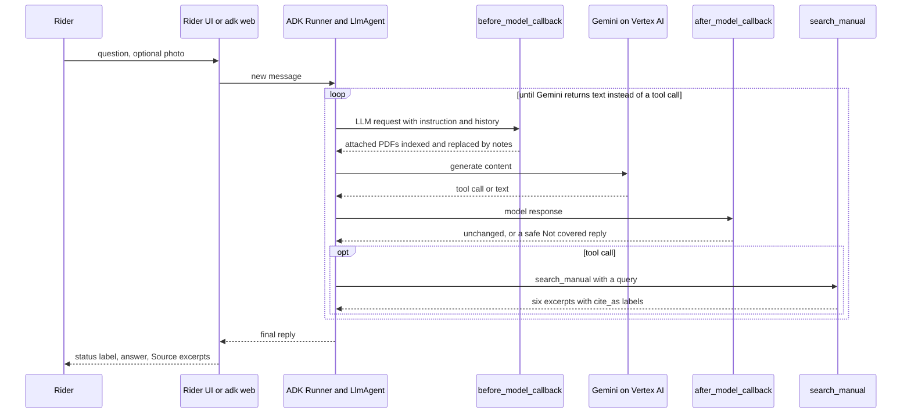

# RAGAgent architecture

This document covers how RAGAgent works in more depth than the [README](../README.md): the
index format, the retrieval maths, the agent loop and its session state, the two callbacks,
how uploads are kept private, how each failure mode is handled, the controls on the public
demo, and why it is built on ADK and Vertex AI. File references are to this repository.

## Components

| Component | Code | Role |
|---|---|---|
| Ingestion | `bike_manual_agent/ingest.py`, `ingest.py`, `scripts/fetch_manuals.py` | PDF -> page-aware chunks -> embeddings -> `index/<manual_id>/` |
| Retrieval | `bike_manual_agent/retrieval.py` | Loads an index; hybrid cosine + BM25 search fused with reciprocal-rank fusion |
| Agent | `bike_manual_agent/agent.py`, `prompts.py` | One ADK `LlmAgent` with three tools and two callbacks |
| Configuration | `bike_manual_agent/config.py`, `env.sample` | Environment variables, Vertex AI or API-key client, optional access-token auth |
| Rider UI | `rider_ui/` | Streamlit MotoMedic interface; runs the agent in-process through an ADK `Runner` |
| Deployment | `deploy/cloud_run.sh`, `Dockerfile` | One Cloud Run service, with the index baked into the image |

The same `root_agent` object is used by every entry point: `adk web`, `adk run`,
`scripts/demo.py`, `evals/` and the rider UI.

## 1. Index data model

Ingestion runs once per manual. It writes three files to `index/<manual_id>/`:

**`meta.json`**: one object per manual.

```json
{
  "manual_id": "royal-enfield-himalayan-450",
  "name": "Royal Enfield Himalayan 450 (BS6) Owner's Manual",
  "source_file": "royal-enfield-new-himalayan-450-owners-manual-bs-six-english.pdf",
  "source_sha256": "cf221a29…",
  "pdf_pages": 149,
  "chunks": 179,
  "embedding_model": "text-embedding-005",
  "chunk_chars": 1200,
  "chunk_overlap": 200
}
```

**`chunks.json`**: a list of chunks.

| Field | Meaning |
|---|---|
| `chunk_id` | `p<pdf_page>-<n>`, with `n` counting from 0 within the page |
| `pdf_page` | 1-based page index in the PDF file |
| `printed_page` | The page number printed on the page, if detected: the first line among the first four non-empty lines that is a bare 1 to 4 digit number. Otherwise `null` |
| `section` | The first all-caps heading among the first eight non-empty lines of the page, or `null` |
| `text` | The chunk text |

**`embeddings.npy`** holds one row per chunk: float32, L2-normalised, 768 dimensions for
`text-embedding-005`.

How the chunks are made:

1. **Extraction.** PyMuPDF extracts the text layer page by page. Private-use bullet glyphs
   become `-`, runs of spaces collapse, and three or more newlines become two.
2. **Skipping.** A page with fewer than 40 characters is treated as blank or image-only and
   skipped. If every page is skipped, ingestion fails with "No extractable text … Scanned
   (image-only) PDFs need OCR first".
3. **Splitting.** Each page is split on its own, so a chunk never spans two pages and every
   chunk keeps exactly one citable page. Chunks are up to 1,200 characters and prefer to break
   at the last newline in the second half of the window. Consecutive chunks overlap by 200
   characters.
4. **Embedding.** Each chunk is embedded as `section + "\n" + text` with task type
   `RETRIEVAL_DOCUMENT`, so headings help recall. Batches hold 32 chunks, with up to five
   attempts and exponential back-off.

The two bundled manuals produce 179 chunks (149 pages) and 192 chunks (134 pages).

Two kinds of manual share the index:

- **Pre-loaded manuals** use ids from `manuals/sources.json`.
- **Uploads** are named `upload-<first 10 hex digits of the PDF's SHA-256>`, with the PDF kept
  in `manuals/uploads/` (`RAGAGENT_UPLOAD_DIR`).

The two bundled PDFs and their index are committed, with attribution in
[`manuals/README.md`](../manuals/README.md), so a clone or a deploy never re-embeds a manual.
Uploads (`index/upload-*`, `manuals/uploads/`) stay out of Git.

`scripts/fetch_manuals.py` keeps the bundled index verifiable and reproducible:

- `--verify-only` checks the committed PDFs against the SHA-256 in `sources.json` and
  reports whether each index was built from that exact file (CI runs the same check as a test).
- Without flags, it downloads any missing PDF from the official URL, writing to a temporary
  file that is moved into place only if the SHA-256 matches.
- It refuses any file whose hash differs.
- With `--ingest`, it rebuilds an index only when the PDF hash, display name, embedding model
  or chunk settings in `meta.json` differ from the current configuration.

## 2. Retrieval

`retrieval.search(manual, query)` ranks every chunk of the selected manual twice:

- **Semantic:** the query is embedded with task type `RETRIEVAL_QUERY` and normalised, so
  cosine similarity is the dot product `V · q` over the normalised chunk matrix `V`.
- **Keyword:** BM25 over `section + text`, using an in-process implementation with
  `k1 = 1.5` and `b = 0.75`. Tokens are lower-case `[a-z0-9]+` runs minus a short stop-word
  list.

  ```text
  idf(t)     = ln(1 + (N - df(t) + 0.5) / (df(t) + 0.5))
  bm25(d, q) = Σ over t in q ∩ d of  idf(t) · tf(t,d) · (k1 + 1) / (tf(t,d) + k1 · (1 - b + b · |d| / avgdl))
  ```

**Fusion.** The two scores are on different scales: cosine sits around 0.3 to 0.7, while BM25
is unbounded. The rankings are therefore fused by reciprocal-rank fusion (RRF) instead of
mixing the scores:

```text
rrf(d) = Σ over r in {cosine, bm25}, if d is in the top 50 of r:  1 / (60 + rank_r(d))      (rank counted from 0)
```

Chunks with a BM25 score of zero (no query term at all) are left out of the keyword ranking,
so they can only surface through the semantic ranking. Without that, queries such as "smoke"
or "backfire" pulled in contents and safety pages through the keyword side.

The six chunks with the highest `rrf` are returned (`RAGAGENT_TOP_K`). RRF needs no score
calibration and no weight tuning, and `k = 60` is the conventional constant. A chunk that
only one ranking likes can still surface. That matters for exact terms such as "ABS",
"MIL" or "10W40", where embeddings are weak and BM25 is strong.

Each result carries the following fields:

- `cite_as`: the label the model must use, `[p. <printed>]`, or `[PDF p. <n>]` when no printed
  number was detected
- `location`: a human-readable label, for example `p. 119 (PDF p. 121) - TROUBLESHOOTING`
- `pdf_page`, `printed_page` and `section`
- `similarity`: the cosine, kept for transparency but not used for filtering
- `text`

`Manual.load` builds the BM25 statistics once. Loaded manuals are cached (LRU of 16), keyed
by folder and the modification time of `embeddings.npy`, so a re-ingested manual is picked up
without a restart. Query embeddings are cached too (LRU of 1,024; agents often repeat searches
such as "troubleshooting"), and one google-genai client is reused for all embedding calls.

**Why there is no similarity threshold.** The README has the measured numbers. In short, a
covered symptom scores 0.56 to 0.70 over its top six excerpts, an uncovered on-topic symptom
(white smoke from the exhaust) scores 0.48 to 0.57, and off-topic text scores about 0.35 to
0.39. No cut-off separates the first two groups, so relevance is decided by the model and
checked by the citation guardrail.

## 3. Agent loop and session state

`root_agent` is an `LlmAgent`:

- name `bike_manual_troubleshooter`
- model `gemini-3.8-flash` (`RAGAGENT_CHAT_MODEL`), temperature 0.1
- wrapped in ADK's `Gemini` class with
  `HttpRetryOptions(attempts=4, initial_delay=1, max_delay=8)`, so transient network, 429 and
  5xx errors are retried with back-off instead of failing the turn
- on Vertex AI, requests carry the billing label `app=ragagent`

Its instruction is built for every model call by `build_instruction()`. It contains the
rules from `prompts.py`, the manuals visible to this session (ids and names only, never
manual text) and the currently selected manual.

| Tool | Behaviour |
|---|---|
| `list_manuals()` | Visible manuals and the current selection |
| `select_manual(manual_id)` | Sets the selection; rejects any id not visible to this session |
| `search_manual(query)` | Runs hybrid search on the current manual in a worker thread (it is an `async` tool, so one rider's embedding call does not block other conversations on the event loop), records the returned page labels under that manual, and returns the excerpts. With no manual selected it returns an error plus the manual list |

The current manual is the selected one if it is visible. If exactly one manual is visible,
that manual is used. Otherwise there is none, and the agent must ask the rider.

Session state keys (ADK session state, per conversation):

| Key | Type | Written by | Used by |
|---|---|---|---|
| `selected_manual` | `str` | `select_manual`, the PDF callback, or the caller when it creates the session (rider UI, `demo.py`, `adk run --state`) | All tools, the instruction |
| `citable_labels` | `dict[manual_id, list[str]]` of normalised labels such as `p.119` or `pdfp.12` | `search_manual` (it accumulates every label returned in the session, per manual) | The citation guardrail, which only accepts labels of the selected manual |
| `uploaded_manuals` | `dict[sha256, manual_id]` | The PDF callback; the rider UI when it starts a conversation on an uploaded manual | `visible_manual_ids()`, which keeps uploads private |
| `failed_uploads` | `dict[sha256, reason]` | The PDF callback, when indexing an attached PDF fails | The PDF callback, so a failed file is not re-processed on every model call |

One rider turn looks like this:



In the runs we inspected, the model searched one to six times per question, with different
wording each time. Early runs also searched for causes the model suspected from general
knowledge (`coolant level check` for white smoke, `engine oil level` for blue smoke) and listed
those sections as "related information". The instruction now forbids searching for suspected
causes and limits related sections to ones that mention the rider's own symptom or component;
[EVAL_RESULTS.md](EVAL_RESULTS.md) shows how often that holds. A photo is part of the rider's message: Gemini sees the image
directly, and the instruction limits it to describing what is visible before it searches.

## 4. The two callbacks

### `before_model_callback`: `index_uploaded_pdfs`

This callback runs before every model call and scans all contents of the outgoing request,
which means the whole conversation history. For each inline `application/pdf` part:

1. Hash the bytes (SHA-256). The manual id is `upload-<sha[:10]>`.
2. If no index for that id exists on disk, write the PDF to `manuals/uploads/` and run
   `ingest()` in a worker thread (`asyncio.to_thread`).
3. **First time this session sees the file:** record `sha -> manual_id` in `uploaded_manuals`,
   set `selected_manual`, and replace the PDF part with a note telling the model the manual is
   indexed and now selected.
4. **Later model calls**, where history replays the same attachment, replace the part with
   "[Earlier attachment: …]" and do not select it again. A rider who switches manuals stays
   switched.
5. If ingestion fails, replace the part with "[Attached PDF could not be indexed: …]" so the
   agent can tell the rider: the `ValueError` message for a scanned PDF, a generic reason
   (and a logged exception) for anything else. The failure is recorded in `failed_uploads`,
   so the file is not re-processed on later model calls.

Only the outgoing request is rewritten, so the model never receives PDF bytes. The stored
session event still holds the original attachment. This path serves PDFs attached to a chat
message (`adk web`, `scripts/demo.py --attach`). The rider UI's sidebar upload does not go
through it: `rider_ui/backend.py` validates the PDF and calls `ingest()` directly. The
rider's next conversation is then created with the uploaded manual already selected and
recorded in `uploaded_manuals`.

### `after_model_callback`: `enforce_citations`

This callback runs after every model response. It ignores partial (streaming) chunks,
tool-call steps and empty text. For a text reply, with thought parts excluded:

1. **Put the status line first.** If the model wrote the status line later in the reply (it
   once opened with the photo description), `status_first()` moves it to the top, so the
   rider UI labels the reply correctly. `reply_status()` also accepts variants such as
   `From the manual:` without bold.
2. **Parse citations.** `_cited_labels()` reads every bracketed group that contains `p.`, for
   example `[p. 119]`, `[PDF p. 12]`, `[p. 66, 75]` and `[p. 12 and p. 13]`. A short range such
   as `[p. 66-67]` (up to six pages) counts as each of its pages. Each page is normalised to
   `p.N` or `pdfp.N`.
3. **Check for unretrieved pages.** If any cited label is missing from the selected manual's
   entry in `citable_labels`, the reply is replaced.
4. **Check for empty claims.** If the reply's status is *From the manual* but it cites
   nothing, the reply is replaced. A reply longer than 400 characters with neither a status
   line nor a citation is replaced as well, since it reads like an uncited answer.

The replacement is a fixed **Not covered by the manual** message. It asks the rider for more
detail or points them to an authorised service centre, and ends with `(guardrail: <reason>)`.
The rider UI shows it as *No supported answer*.

The check is intentionally strict and cheap: plain Python, no model call, unit-tested in
`tests/test_offline.py`. Known edges:

- Citations written outside square brackets ("see page 119") are not parsed.
- A range longer than six pages is treated as a single unretrieved label, so the reply is
  replaced. This errs on the safe side.
- A short reply (400 characters or less) without a status line or citation passes, so that
  plain clarifying questions get through.
- The guardrail checks that each cited page was retrieved, not that the sentence says what the
  page says. That is measured by the LLM judge in the evaluation, not enforced at run time.

## 5. Session privacy of uploads

- Uploaded indexes live in the same `index/` folder as the bundled ones. However,
  `visible_manual_ids(state)` hides every `upload-*` id except those recorded in this session's
  `uploaded_manuals`.
- `select_manual` and `search_manual` validate against the visible ids, so a session cannot
  use another session's upload even if it guesses the id.
- Ids are derived from the content hash. Two people who upload the same file share one
  on-disk index and pay for embedding once, but each sees it only after uploading it.
- In the rider UI, an uploaded manual is listed only in that browser session
  (`st.session_state`). Conversations started on it carry the matching `uploaded_manuals`
  entry. *Start a new conversation* keeps the upload available in the same browser session.
- Uploads are not deleted when a conversation ends. They remain on the instance's local disk
  until the instance is recycled. On Cloud Run that disk is in-memory and is never shared
  between instances.

Tests: `test_uploaded_manuals_are_private_to_their_session` and
`test_uploaded_pdf_is_indexed_selected_and_hidden_from_the_model`.

## 6. Rider UI integration

Streamlit re-runs its script on worker threads, while ADK is asyncio-based. `rider_ui/backend.py`
therefore keeps one long-lived event loop on a daemon thread, with one ADK
`Runner(app_name="motomedic_rider_ui")` and an `InMemorySessionService`.

1. A question is submitted with `run_coroutine_threadsafe`. The script polls the resulting
   future and a progress queue that is fed from the agent's real events: "Looking at your
   photo…", "Searching the manual: “…”", "Reading the manual excerpts…".
2. The final text is split into the status line, which becomes a label, and the body. Each
   cited label is mapped back to the excerpt it was retrieved from, for the
   *Source · p. …* expander.
3. Model text is rendered as Markdown with links, images and LaTeX neutralised. HTML in model
   output is not rendered.
4. A question that takes longer than 240 s is abandoned with a timeout message.
5. A failed model call shows "MotoMedic couldn't reach the answer service just now, so nothing
   was checked against the manual", never a partial answer.
6. Conversations idle for more than 2 hours are deleted.

## 7. Failure modes and how each is handled

| Situation | Handling |
|---|---|
| **Scanned or image-only PDF** | `ingest()` raises "No extractable text … need OCR first". The CLI exits with that error, the rider UI shows it, and a chat attachment is replaced by a note so the agent can explain. In a partly scanned PDF, the image-only pages are skipped and their content is simply not searchable. |
| **No manual selected** | With several manuals and no selection, the instruction says "Currently selected manual: none" and tells the agent to ask which bike (*Need more information*) and never to pick one. `search_manual` returns an error and the manual list if it is called anyway. The rider UI prevents this case: the question box stays disabled until the rider confirms "My motorcycle is a …". Eval cases `clar-*` cover it. |
| **Wrong bike** | The rider confirms the model in the UI, and the selector locks once a conversation starts, so a different bike means a new conversation. If a rider says mid-chat that they ride something else, the instruction tells the agent to switch with `select_manual` or say that manual is not loaded. Residual risk: if the rider's bike is not loaded and they never say so, answers come from the selected manual. The UI shows the selected manual in the header and in every *Source* panel. |
| **Irrelevant or unclear photo** | The instruction says to describe only what is visible, not to diagnose from the image, and then to search the manual for the symptom in words. If nothing relevant is found, the reply is *Not covered* or *Need more information*. The UI accepts only JPEG, PNG and WebP (checked by magic bytes), up to 5 MB, three per conversation. There is no image classifier; the model decides what the photo shows. |
| **Model cites a page it did not retrieve** | The guardrail replaces the reply with the safe *Not covered* message and states the reason. |
| **Model claims "From the manual" with no citation** | Replaced in the same way. |
| **Model guesses a cause in a "Not covered" reply** | Forbidden by the instruction and measured by the evals' `must_not_mention` lists. It is not blocked deterministically, because this is the per-claim gap. |
| **Model or network error** | Gemini calls are retried (4 attempts, back-off from 1 s up to 8 s). If they still fail, the rider UI shows an explicit "nothing was checked against the manual" message, and `scripts/demo.py` stops with the exception. |
| **Oversized or abusive input** | Questions are limited to 100 words and 2,000 characters. Rate limits and daily caps are described below. In the UI, manuals must be real PDFs that open in PyMuPDF, up to 40 MB and 400 pages. |
| **Same PDF uploaded again** | The same hash gives the same id, so the existing index is reused and nothing is embedded twice. |
| **Wrong edition of a bundled manual** | `fetch_manuals.py` refuses a PDF whose SHA-256 differs from `sources.json`. `--verify-only` also flags an index built from a different file. |

## 8. Security and cost controls on the hosted demo

**Identity and secrets**

- Cloud Run runs as the service account `ragagent-run`, which holds only
  `roles/aiplatform.user`.
- The app uses Application Default Credentials. No API keys exist, and none are baked into
  the image.
- Locally, ADC or a short-lived `GOOGLE_OAUTH_ACCESS_TOKEN` is used. The token is used only
  in memory and is never written to disk.

**Public by design, so bounded.** The service is `--allow-unauthenticated`, and spend is
bounded at several levels:

| Control | Setting |
|---|---|
| Instances | `--max-instances 1`, `--min-instances 0`, `--concurrency 8`, `--cpu 1 --memory 2Gi`. `--timeout 3600` and `--session-affinity` serve Streamlit's long-lived websocket: the rider UI enforces its own 240 s limit per question |
| Questions per day, all visitors (UTC) | `RAGAGENT_DAILY_QUESTION_CAP`, default 300 |
| Manual uploads per day | `RAGAGENT_DAILY_UPLOAD_CAP`, default 10 |
| Questions per minute, per visitor | `RAGAGENT_RATE_PER_MIN`, default 8 |
| Turns per conversation | `RAGAGENT_MAX_TURNS`, default 30 |
| Input size | 100 words / 2,000 characters per question; photos up to 5 MB, 3 per conversation; manuals up to 40 MB / 400 pages |
| Billing | a monthly budget alert on the project, and the label `app=ragagent` on Gemini requests |

The counters are in-process, which is why `max-instances` is 1. They reset when the instance
restarts. A budget alert notifies; it does not cap spend.

**Untrusted input**

- PDFs are only text-extracted, and only after the magic-byte, size and page-count checks.
- Photos are type-checked by magic bytes.
- The agent's tools are read-only and scoped to the session's visible manuals. It has no
  tool that writes files, fetches URLs or runs code.
- The public UI accepts PDFs only through the sidebar upload, which applies the limits above.
  The unauthenticated ADK dev server (`adk web`) is for local use and is not deployed.

**Container and Streamlit settings**

- The `Dockerfile` builds from `python:3.12-slim` and runs as a non-root user (uid 10001).
  That user can write only to `index/` and `manuals/`, which uploads need.
- The image contains the runtime packages (`bike_manual_agent/`, `rider_ui/`), `.streamlit/`,
  `samples/`, `manuals/sources.json` and the prebuilt `index/`.
- `.gcloudignore` and `.dockerignore` keep out the PDFs, `.env` files, tests, scripts, evals,
  docs and Git metadata.
- `.streamlit/config.toml` shows the viewer toolbar only (no developer menu), disables usage
  telemetry, enables XSRF protection and caps uploads at 40 MB at the server.

**Prompt injection through manual text.** An uploaded PDF could contain instructions aimed at
the model. The damage is contained:

- the upload is visible only to the session that uploaded it;
- the tools cannot act outside the index;
- the citation guardrail still applies.

The remaining risk is that an uploader can make the agent say odd things to themselves.

**Data retention**

- Sessions live in memory.
- Uploaded PDFs and their indexes stay on the instance's in-memory disk until it is recycled.
- The UI logs answer status, timing and counts, not question text. Cloud Run keeps its
  standard request logs.

**Known weakness.** The per-visitor key is the last `X-Forwarded-For` entry, which Cloud Run's
front end appends and a client cannot forge. Visitors behind one NAT share a limit, and someone
determined can still rotate addresses, but the global daily caps bound cost either way.
Authentication, Cloud Armor and abuse detection are out of scope for the MVP.

## 9. Why ADK and Vertex AI

**ADK** provides the parts this project would otherwise have to write and test itself:

- the tool-calling loop, including repeated searches within one turn;
- per-session state;
- first-class `before_model_callback` / `after_model_callback` hooks, which is exactly where the
  PDF interception and the citation guardrail belong.

It also provides `adk web`, a developer UI that shows every event, tool call and state change,
plus `adk run` and a `Runner` that embeds the same agent in scripts, the evals and the
Streamlit app. Adding a second agent later, for example a dedicated verifier, is a composition
change rather than a rewrite.

**Vertex AI** puts the multimodal chat model (Gemini reads the rider's photo) and the
embedding model under one project, with IAM, quotas, billing labels and budgets. On Cloud Run
the app authenticates as a service account, so no long-lived keys exist anywhere.

**Managed retrieval was considered.** Vertex AI RAG Engine and Vertex AI Search would replace
`index/` and `retrieval.py`. They were not used here for three reasons:

- the guardrail depends on exact, printed-page citation labels, which the custom chunker
  controls;
- a local index keeps retrieval inspectable and deterministic, and testable offline in CI;
- the demo needs no extra infrastructure.

Moving to a managed store is the natural step once there are many manuals.

## 10. Configuration reference

| Variable | Default | Purpose |
|---|---|---|
| `GOOGLE_GENAI_USE_VERTEXAI` | (unset) | `TRUE` for Vertex AI. `FALSE` uses `GOOGLE_API_KEY`, which was not exercised for the MVP |
| `GOOGLE_CLOUD_PROJECT`, `GOOGLE_CLOUD_LOCATION` | (unset) | Vertex AI project and location (`global` works for both models) |
| `GOOGLE_OAUTH_ACCESS_TOKEN` | (unset) | Optional short-lived token used instead of ADC |
| `RAGAGENT_CHAT_MODEL` | `gemini-3.8-flash` | Chat model |
| `RAGAGENT_EMBEDDING_MODEL` | `text-embedding-005` | Embedding model (re-ingest after changing it) |
| `RAGAGENT_CHUNK_CHARS`, `RAGAGENT_CHUNK_OVERLAP` | `1200`, `200` | Chunking (re-ingest after changing them) |
| `RAGAGENT_TOP_K` | `6` | Excerpts per search |
| `RAGAGENT_INDEX_DIR`, `RAGAGENT_UPLOAD_DIR` | `index/`, `manuals/uploads/` | Storage locations |
| `RAGAGENT_BILLING_LABEL` | `ragagent` | Value of the `app` label on Gemini requests |
| `RAGAGENT_DAILY_QUESTION_CAP`, `RAGAGENT_DAILY_UPLOAD_CAP`, `RAGAGENT_RATE_PER_MIN`, `RAGAGENT_MAX_TURNS` | 300, 10, 8, 30 | Rider UI guards |

`python scripts/fetch_manuals.py --ingest` notices a changed embedding model or changed chunk
settings and rebuilds the affected indexes.

## 11. Tests

All tests are provider-free and run in CI (`python -m pytest -q`):

- `tests/test_offline.py`:
  - chunking keeps the printed page and section;
  - hybrid search surfaces a keyword match even when the semantic vector points elsewhere;
  - eight guardrail cases: accepted citations, unretrieved pages, missing citations, and
    "Not covered" or "Need more information" replies;
  - upload privacy;
  - the upload callback: indexed, selected, bytes hidden, no re-selection on later turns.
- `tests/test_rider_ui.py` uses Streamlit `AppTest` with a fake backend. It checks the layout
  and the bike confirmation, a cited answer, the sample-photo flow, refusal of a long question,
  status parsing and the rate limits.

Live behaviour against the real model is measured separately by `evals/`, with results in
[EVAL_RESULTS.md](EVAL_RESULTS.md).
