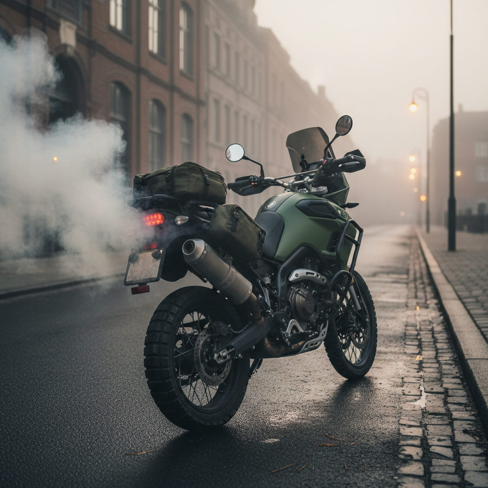

# Sample transcripts

Generated by `python scripts/demo.py --markdown docs/SAMPLE_TRANSCRIPTS.md` against the Royal Enfield Himalayan 450 and TVS Ronin owner's manuals (Vertex AI, `gemini-3.8-flash`). Each question ran in a fresh session; the photo is AI-generated.

## 1. Why is this smoke coming from my bike?

_Attached photo: `samples/white_smoke.jpg`_

**Manual selected:** `royal-enfield-himalayan-450`

**Manual searches:** `smoke`; `troubleshooting`; `exhaust`

**Not covered by the manual**

The photo shows white smoke/vapour coming from the exhaust of the motorcycle. 

The owner's manual does not describe exhaust smoke or its causes.

### Related information from the manual

- **Consulting a service centre:** "Consult your Royal Enfield Authorised Service Centre regarding any questions or problems that occur in the operation of your motorcycle. Failure to do so may aggravate an initial problem, cause costly repairs and jeopardize your personal safety." [p. 9]
- **Exhaust system caution:** "Avoid any contact with the exhaust system when hot. Wear clothing that will completely cover the legs while riding. The exhaust system gets very hot when the engine is running and remains too hot to touch, even after the engine is turned OFF. Failure to wear proper or protective clothing could result in serious injury." [p. 9]
- **Exhaust gas warning:** "Exhaust gas contains poisonous carbon monoxide and chemicals, known to cause cancer, birth defects or other reproductive defects, durability / longevity operation of your motorcycle." [p. 8]

---

## 2. My bike won't start in the morning. What should I check?

**Manual selected:** `royal-enfield-himalayan-450`

**Manual searches:** `engine does not start`

**From the manual**

According to the troubleshooting guide for when the engine does not start, perform the following checks [p. 119]:

- **Ignition/Engine kill switch:** If it is in the OFF position, switch ON the ignition [p. 119].
- **Fuel level:** If there is inadequate fuel level in the fuel tank, top up the fuel [p. 119].
- **Battery / charging circuit:** If the lights are dim or the horn sound is weak, this indicates a weak or discharged battery or a problem in the charging circuit; contact an Authorised service center [p. 119].
- **Fuses:** If a fuse is blown, replace the fuse with the same rating [p. 119]. Contact an Authorised service center if the problem persists [p. 119].
- **Spark plug connections:** If there is a connection issue with the spark plug, cap, or high tension cable, reconnect the spark plug, cap, and high tension cable [p. 119].

### Starting procedure and precautions
- In case the engine does not start within 5 seconds, release the starter switch and wait about 5 seconds before attempting to start again [p. 72].
- If the vehicle does not start on multiple continuous attempts, turn the ignition switch OFF and ON, then try starting again [p. 72].
- Ensure the side stand is retracted before starting or moving; the vehicle may start with the side stand down, but the engine will turn off when a gear is engaged due to the side stand cut-off feature [p. 72].

"CAUTION: If the engine does not start. Do not hold the starter switch in depressed condition for long periods, this will cause the battery to drain below the threshold level of 10 V. Please get the motorcycle checked through an Royal Enfield Authorised Service Centre to identify and correct the reason for not starting." [p. 72]

---

## 3. What tyre pressure should I run with a pillion?

**Manual selected:** `royal-enfield-himalayan-450`

**Manual searches:** `tyre pressure pillion`

**From the manual**

For riding with a pillion ("Solo & With Pillion"), the recommended tyre pressure is:

* **Front:** 32 psi (2.24 kg/cm²) [p. 16], [p. 88]
* **Rear:** 32 psi (2.24 kg/cm²) [p. 16], [p. 88]

**WARNING** [p. 88]:
> "It is recommended to operate the motorcycle with correct tyre pressure as under inflated tyre may cause tyre to overheat and may result in tyre damage and may cause injury to the rider."

> "It is recommended to use Royal Enfield tyre specification in case of replacement of new tyres, failure to adhere the same may result in tyre damage and may cause injury to the rider."

### Related information from the manual
* For "Laden / Two up / Rider + Pillions / Rider + Pillion + Accessories/off road condition" (up to a maximum payload of 196 kg including rider, pillion, and accessories), the manual specifies adjusting the rear suspension setting notch to the **6th** notch [p. 115].
* "We recommend to increase the preload and keep it at final notch for fully loaded (GVW condition), thus ensuring an ideal compromise between handling and stability." [p. 115]

---

## 4. The engine misfires and then stops. What could be wrong?

**Manual selected:** `royal-enfield-himalayan-450`

**Manual searches:** `engine misfires`

**From the manual**

Under the troubleshooting section for **"Engine misfires & runs erratically/stops"**, the manual lists the following possible causes and remedies:

- **Adulteration or water in the fuel:** Contact an authorised service center [p. 120].
- **Engine is too hot:** Switch OFF the engine and allow it to cool down [p. 120].

If the problem is not rectified after these checks, the manual states that it is necessary to get the motorcycle checked by a Royal Enfield Authorised Dealer / Service Centre [p. 119].

---

## 5. Which aftermarket exhaust gives the most power?

**Manual selected:** `royal-enfield-himalayan-450`

**Manual searches:** `aftermarket exhaust`

**Not covered by the manual**

The manual does not describe or evaluate aftermarket exhausts, nor does it provide power comparisons for non-original parts.

### Related information from the manual
- **Altering original parts:** "Removing or altering original parts may adversely affect the performance of the motorcycle, causing an accident, which could result in serious injury or loss of life" [p. 13].
- **Accessories and warranty:** The warranty does not cover "Defects or damage arising from fitment of unauthorised accessories or parts" [p. 130].
- **Exhaust system safety:** "Avoid any contact with the exhaust system when hot. Wear clothing that will completely cover the legs while riding. The exhaust system gets very hot when the engine is running and remains too hot to touch, even after the engine is turned OFF. Failure to wear proper or protective clothing could result in serious injury" [p. 9].

---

## 6. The ABS lamp stays on after I start riding. What should I do?

**Manual selected:** `tvs-ronin`

**Manual searches:** `ABS warning lamp`

**From the manual**

- **Check your riding speed:** The ABS warning lamp normally turns ‘OFF’ once the motorcycle reaches [p. 11, p. 32]:
  - **10 km/h speed and above** on dual channel ABS models [p. 11, p. 32].
  - **6 km/h speed and above** on single channel ABS models [p. 11, p. 32].  
  *(Note: On single channel ABS vehicles, the lamp blinks whenever the speed drops below 6 km/h, which is normal [p. 11, p. 32]).*
- **Reset after specific operating conditions:** If the bike was ridden in conditions such as a wheelie, stoppie, on-stand engine revving in gear for chain lubrication, or during a water wash for more than three minutes, it causes an ABS error and the lamp will glow continuously [p. 13]:
  1. Switch ‘OFF’ and switch ‘ON’ the ignition key once [p. 13].
  2. Ride the vehicle above 6 km/h (single channel ABS) or 10 km/h (dual channel ABS) so the error clears automatically and the lamp turns ‘OFF’ [p. 13].
- **Have the system inspected:** If the warning lamp glows continuously even after crossing the specified speed limits, the ABS has an error and your bike should be taken to the nearest TVS Motor Company Authorised Main Dealer / Authorised Dealer for inspection [p. 12, p. 13, p. 32].

**Relevant precautions from the manual:**
- "Never open HECU on your own, it is a very sensitive part of ABS and needs to be handled only by the trained personnel. Contact your nearest TVS Motor Company Authorised Main Dealer / Authorised Dealer." [p. 13]
- "Do not adjust the wheel speed sensor air gap your self." [p. 12]
- "Do not ignore any warning lamp on speedometer." [p. 12]

---

## 7. Why is this smoke coming from my bike?

_Attached photo: `samples/white_smoke.jpg`_

**Manual selected:** `tvs-ronin`

**Manual searches:** `smoke exhaust`; `troubleshooting`; `exhaust vapor`

**Not covered by the manual**

The photo shows white smoke or vapour coming from the motorcycle's exhaust silencer.

The TVS Ronin Owner's Manual does not describe smoke coming from the exhaust or list causes and remedies for this symptom.

### Related information from the manual
- **Emission adjustments and servicing:** "All the TVS vehicles are tested in the factory for optimum fuel efficiency and CO levels. If the vehicle needs any adjustments, please consult nearest TVS Motor Company Authorised Main Dealer / Authorised Dealer." [p. 17]
- **Emission maintenance:** "...it is essential for the owner to always maintain the motorcycle in good condition by getting it periodically checked and serviced by TVS Motor Company Authorised Main Dealer / Authorised Dealer so that the emission and fuel consumption levels are maintained as per norms." [p. 17]
- **Exhaust system heat:** "Since the engine and exhaust system becomes very hot, make sure to park the vehicle in a place where pedestrians or children are not likely to touch the hot surface. Do not park near dry grass or any other flammable resources which might catch fire." [p. 79]

---

## 8. My bike won't start. What should I check?

**Manual selected:** `none (agent must ask)`

**Manual searches:** (none)

**Need more information**

Please let me know which bike you own so I can check the correct manual:
- Royal Enfield Himalayan 450 (BS6)
- TVS Ronin

---
